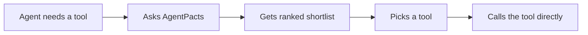
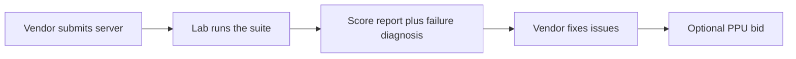
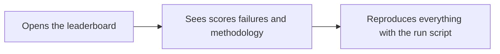

# AgentPacts

**Before an agent picks a tool, it should know whether the tool works. AgentPacts runs the tools so agents don't have to guess.**

Built for YC's Make Something Agents Want hackathon, October 2026.

**Live MCP server:** `https://fast-forge-ydikc.run.mcp-use.com/mcp` (tools: `search_tools`, `get_scores`, `list_categories`)

## The problem

AI agents can't tell good tools from bad. Discovery tools rank vendor-written descriptions, which is marketing copy. Nobody runs the tools to check.

## The lab model

AgentPacts tests tools itself, on fixed tasks with known right answers, and publishes only what it can verify. New categories are added as they are scored.

The results are served through an MCP server that agents query at the moment they choose a tool, so the choice is based on evidence, not on how a tool describes itself. AgentPacts is consulted when choosing and absent when executing. Scores are compiled into the server ahead of time, and it never sees the agent's tool traffic.

## What is live today

The vision is bigger than what is live today: one category, three servers, just enough to show you how the machine works. The machine is the product; the table below is one run of it.

## How each side uses it

### Agents



AgentPacts never sees the tool traffic.

### Vendors



Bids are valid only among tied servers that clear the quality bar. The full rules are under [Sponsored placements](#sponsored-placements).

### Observers



Today the leaderboard is the table below, the per-run traces in `traces/`, and the live MCP server. The run script is `run_bakeoff.sh`.

## Example: 3 transcription servers, tested head-to-head

Example output from one bake-off (October 17, 2026). This table is a snapshot: query the live server for current scores. The system runs bake-offs continuously across task categories.

Transcription, suite `transcription-v1`:

| Server | Suite score | noisy-accented | voice-memo | long-meeting |
|---|---|---|---|---|
| [sanzaru](https://github.com/TJC-LP/sanzaru) (OpenAI API) | **9.1** | 8.5 | 9.6 | 9.4 |
| [agent-voice-mcp](https://github.com/hakanai-ai/agent-voice-mcp) (local whisper.cpp) | **2.3** | 6.8 | FAIL | 0.1 |
| [local-stt-mcp](https://github.com/SmartLittleApps/local-stt-mcp) (local whisper.cpp CLI) | **2.2** | 6.7 | FAIL | FAIL |

Each failure traces to a reproducible bug in that server; `get_scores(server_id)` returns the diagnosis and the fix.

## Business model

PageRank plus AdWords for the agent economy: an independent quality ranking, plus placement that can be bought only where the ranking says the options are equal.

Today: which tool. Tomorrow: which model, which agent, and eventually which product or service. Anywhere an agent makes a choice, it should be able to ask what actually works.

## How the bake-off works

We call one round of head-to-head testing a bake-off.

1. **Fixed tasks with ground truth.** Each task is an audio file plus the exact words spoken and a list of key terms (names, numbers, jargon). The suite has three tasks:
   - `noisy-accented`: 45 s accented speech over phone-quality audio with background noise.
   - `voice-memo`: 36 s two-speaker phone memo (`.m4a`) with a real-world filename containing a comma.
   - `long-meeting`: 10-minute four-speaker meeting (`.m4a`) with a silent lead-in and silent gaps.
2. **Fixed harness.** Every server is called the same way, with its own default settings, through MCP over stdio. No LLM sits in the loop, so nothing varies between servers except the server.
3. **Repeated runs.** Each server runs every task 3 times.
4. **Scores baked into the server.** Results are compiled into the deployed MCP server as static data.

### Reproduce

```bash
./run_bakeoff.sh                      # all servers: score, write traces/, bake into mcp-server/src/scores.ts
./run_bakeoff.sh hakanai,localstt     # subset (writes traces/partial.json, does not bake)
python3 fixtures/build_fixtures.py    # regenerate the voice-memo and long-meeting fixtures
cd mcp-server && npx mcp-use deploy   # publish the new scores
```

Requirements: `uv`, Node 22+, ffmpeg, a local whisper.cpp server on port 2022 (`uvx voice-mode service install whisper`), and `OPENAI_API_KEY` in `servers/sanzaru/.env` for the OpenAI-backed server. Per-run traces (raw outputs, errors, latencies) are written to `traces/`.

## Metrics glossary

- **WER (word error rate):** the share of words the transcript gets wrong compared with what was actually said. Lower is better; 0.10 means about 1 word in 10 is wrong. Text is normalized first (OpenAI's Whisper normalizer), so "$47,300" and "forty-seven thousand three hundred" count as the same.
- **Key-term recall:** the share of important names, numbers and jargon the transcript caught. Higher is better.
- **Task score (0 to 10):** `10 × (0.6 × (1 − WER) + 0.4 × key-term recall)`. 60% overall accuracy, 40% getting the details that matter.
- **Failed runs score 0.** A crash, timeout, empty result, or an error returned as text all count as a failed run, because reliability is part of quality.
- **Runs:** how many of the attempts completed, e.g. `3/3`. `0/3` on a task means the server failed that task.
- **Latency:** average seconds per completed call, including server start-up.
- **Suite score:** the average of the task scores.
- **95% CI (confidence interval):** the likely range of the true score, based on the spread across runs. Local servers are deterministic, so their range is often a single number.
- **Tie:** two scores less than 0.5 apart (or with overlapping confidence intervals at suite level). The difference isn't meaningful.

## Sponsored placements

AgentPacts' business model is paid placement that cannot buy a score. The rules are enforced in code (`mcp-server/index.ts`, `sponsorEligible`):

- Rankings and scores are never for sale.
- An offer can only appear **among statistically tied servers**.
- A bidder must clear the **6.0 quality bar** on its unrounded score, must have **failed no task** in the suite, and must have **completed every run** of the task being ranked.
- Every outcome is disclosed in the output. An accepted bid prints `Sponsored: <server> | bid_usd_per_selection: … | terms: … | status: … | ranking_affected: no`. A refused bid prints `Sponsored: none | declined_bid: <server> | reason: <why>`.

**Status:** the mechanism is live on the deployed server and tested against five edge cases: a failed task hidden in an average, a failed run on the ranked task, 5.95 rounding up to 6.0, a missing unrounded score, and a clean tie. The only bid today is a **seeded demo bid placed by the AgentPacts team**, marked `ILLUSTRATIVE` (`mcp-server/src/offers.ts`). No real money is involved. In production, bids arrive via the vendor PPU campaign flow. On current data the seeded bid is refused, because its server fails two tasks.

## For vendors

- **Get scored:** submission is manual today. Send us your MCP server's repo; we add it to `harness/servers.json` and run the same suite. You get the score, the per-run traces, and a diagnosis of any failure.
- **Bid format (PPU, per selection):** `{ server_id, bid_usd_per_selection, terms }`. A bid is only eligible under the rules above.
- **Status:** the scoring pipeline and the placement rules are live. The self-serve submission and PPU campaign flow are not built yet.

## Honest limitations

- **Small sample:** 3 servers, 1 category (transcription), 3 tasks.
- **Synthetic fixtures:** audio is generated with macOS text-to-speech plus added noise, not recorded from real people. Real recordings will score differently.
- **Seeded bid:** the only sponsored offer is a demo bid placed by us.
- **Keyword matching:** queries are mapped to categories and tasks by keyword, so unusual wording can match the wrong task. For example, "call" is a transcription keyword.
- **Server defaults only:** we test each server as an agent would call it, with no tuning. A server with a better non-default configuration may score higher.
